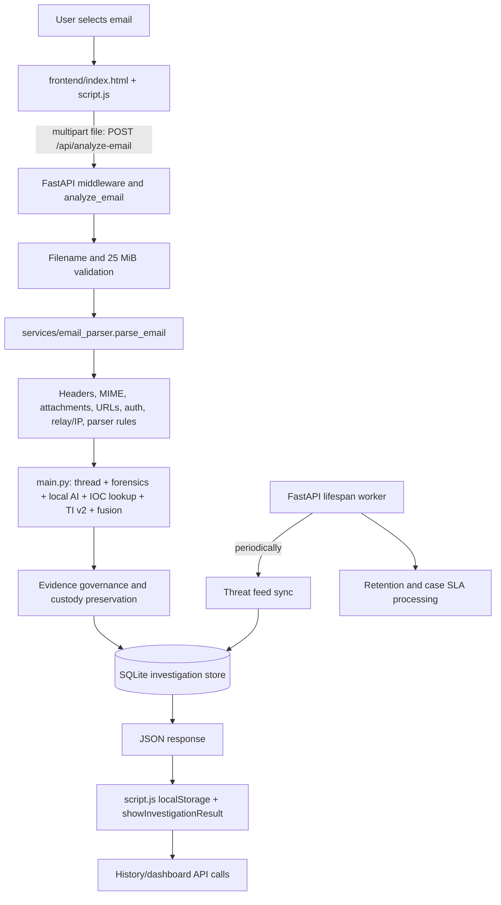

# MailTrace-AI — Step 2: Application Architecture Map

**Audit date:** 2026-10-12  
**Repository:** `D:\jaideep\practice\practice\mailtrace ai\MailTrace-AI--`  
**Scope:** Read-only source inspection and local OpenAPI inspection. The only file created for this step is this report. No source code, dependencies, or runtime data were changed.

## Method and evidence limits

The requested Step 1 report, `phase1_step1_repository_audit.md`, is not present at the repository root. This map therefore re-checked the relevant source and route registrations directly rather than relying on that handoff. The source tree and runtime state can differ: this report describes checked-in/current source plus explicitly called-out local runtime observations. Secrets and stored evidence contents were not printed or copied into this report. A local OpenAPI document was used to confirm registered HTTP paths/methods and request schemas; code was read to establish handler behavior and connections.

**Confidence labels:** High = directly confirmed in route/source/config. Medium = behavior is assembled from multiple source paths or depends on runtime configuration. Unverified = source inspected does not establish the claim.

## A. High-level architecture summary

MailTrace is a static browser frontend plus a Python FastAPI backend. The supplied launcher starts the frontend's Python static server on `127.0.0.1:5503` and Uvicorn on `127.0.0.1:8002`. The browser sends an uploaded `.eml`/`.msg` as multipart form data to `POST /api/analyze-email`. The backend validates extension and byte count, parses the message, runs URL/authentication/IP/email-forensics/thread/AI/threat-intelligence analysis, assembles a result, preserves evidence, and saves the investigation to SQLite before returning JSON. The browser stores the latest response in local storage and renders the result; history and dashboard data are fetched through other APIs.

The main analysis is request-bound, not submitted to a job queue. It includes synchronous CPU work, SQLite operations, and synchronous network lookups on a request path. There is a periodic in-process worker for threat-feed synchronization, retention, and case SLA processing. SQLite is the primary application store, with a separate local integrity-anchor store and evidence files/ledger under runtime data.

## B. Verified request path and component connections

### Start and entry points

| Entry | Verified behavior | Confidence |
|---|---|---|
| `START_MAILTRACE.bat` | Invokes the PowerShell launcher. | High |
| `START_MAILTRACE.ps1` | Selects Python (prefers the configured backend virtual environment when present), launches `uvicorn main:app` from `backend` on `127.0.0.1:8002`, starts `python -m http.server 5503 --bind 127.0.0.1` for `frontend`, then probes readiness and the frontend page. `MAILTRACE_RELOAD=1` enables Uvicorn reload. | High |
| `backend/main.py` | Defines the FastAPI application, middleware, mounts routers, declares many `/api` handlers, initializes persistence and starts lifespan work. Its direct `__main__` launch uses port 8000 with reload, unlike the supported launcher’s 8002. | High |
| `frontend/index.html` | Static application shell, CSS and JavaScript includes; sets the browser API base to `http://127.0.0.1:8002`. | High |

### Upload-to-result call chain

1. **Browser UI:** `frontend/index.html` loads `frontend/script.js`. The upload event handler in `script.js` creates `FormData` with field `file` and posts to `/api/analyze-email` using the configured API URL. On success it stores the result in `localStorage` (`mailtrace_analysis`), refreshes dashboard/history data, and calls `showInvestigationResult(...)`.
2. **API and guardrails:** `backend/main.py::analyze_email` receives `UploadFile`; `_analyze_email` checks filename/extension (`.eml` or `.msg`), reads at most `MAX_EMAIL_UPLOAD_BYTES + 1` (25 MiB + one byte), returns 413 above the 25 MiB limit, and passes bytes to `services.email_parser::parse_email`. The main route returns 400 for an unsupported/missing filename and has a broad failure handler that returns 500 with the exception text.
3. **MIME parsing and first-pass analysis:** `backend/services/email_parser.py::parse_email` uses Python's `BytesParser(policy.default)` for EML. MSG uses `extract_msg.openMsg(..., delayAttachments=True)`, converts it to an `EmailMessage`, then parses the normalized bytes. It extracts headers/body/HTML/attachments and calls URL analysis, URL deception/link analysis, authentication analysis, received-chain/IP extraction, legacy `services.ip_intelligence::analyze_ips`, and parser threat rules. It returns a structured dictionary; it does not itself persist the investigation.
4. **Additional analysis in `backend/main.py::_analyze_email`:** builds thread analysis with `email_thread_intelligence`, email forensics with `email_forensics::analyze_email_forensics`, local model result via `email_ai` inference, extracts/normalizes IOCs and looks them up in locally synchronized threat-intelligence data, calls the v2 threat-intelligence analysis engine, and calls `email_ai::analyze_email_intelligence` for fusion. Several optional stages catch exceptions and add error/status data to the result. Parser rule score is retained for transparency; when fusion reports a valid `ANALYZED` score, main uses fusion as the final authoritative score.
5. **Evidence and persistence:** `main.py::_build_evidence_governance` classifies the result and calls evidence-custody registration/preservation for original bytes, then attempts integrity anchoring and assembles custody/retention details. `database/database.py::save_investigation` stores the investigation identifiers, metadata, score/verdict/confidence and serialized analysis JSON. The handler returns `{success, investigation_id, filename, analysis}`.
6. **Browser rendering/history:** `frontend/script.js::showInvestigationResult` renders analysis. The UI also requests investigation lists/details and dashboard/case/campaign data. `frontend/realtime-threat-intelligence.js` loads live threat data and consumes an SSE stream.

The diagram shows the analysis flow confirmed in code. Optional stages can fail independently and contribute error/status fields; the endpoint itself still has a broad outer exception path. The worker is a separate in-process background path, not part of each upload.

### Upload and MIME boundaries

| Input path | Validation/limits verified | Temporary storage and cleanup | Confidence |
|---|---|---|---|
| `POST /api/analyze-email` | Extension allowlist `.eml`/`.msg`; read limit 25 MiB; 413 if exceeded. No explicit MIME header or file-signature validation was found in the handler. | Handler reads into memory and does not create a separate upload temp file. Starlette/FastAPI `UploadFile` may use framework spooling; exact runtime spool behavior is not configured here and is not asserted. | High for handler; framework detail unverified |
| `POST /api/analyze-thread` | Accepts multiple `.eml` uploads; handler permits up to 100 files but calls `read()` without a per-file or aggregate byte limit. | No application-managed temporary file or cleanup found. Framework upload spooling is not verified. | High |
| `POST /api/webhooks/email` | Streams request bytes into a buffer with a 25 MiB cap; validates event metadata, timestamp window, and HMAC-SHA256 over metadata plus raw payload; event IDs support idempotency/lease handling. Optional SMTP metadata must be supplied as a complete set. | In-memory collection; no app temp file found on this path. Lease renewer runs while processing. | High |
| Attachment analysis | `email_parser.py` defines per-attachment decoded limit 10 MiB, aggregate 50 MiB, at most 200 reported attachments/50 static analyses; ClamAV scan count/time budgets are also bounded. | Analysis is in memory; no attachment extraction-to-disk workflow was confirmed. | High |

The 25 MiB message cap does not protect the separate thread endpoint from oversized aggregate uploads. A filename suffix is not equivalent to validating actual content type or parser resource usage.

## C. API inventory

The entries below are actual FastAPI registrations confirmed through OpenAPI and route source. Authentication labels refer to the global middleware unless noted. **Default protected** means bearer OIDC/API-key authentication, with role checks by route/method; local development has a loopback principal path. Health/readiness/auth configuration are exceptions. The webhook has its own HMAC signature check. Employee endpoints require employee authorization; SOC routing endpoints have analyst/admin role restrictions. OPTIONS preflight is handled separately.

### Core analysis and investigation

| Method and route | Purpose and verified input/output | Authentication |
|---|---|---|
| `POST /api/analyze-email` | Multipart `file`; JSON `{success, investigation_id, filename, analysis}`. | Default protected (loopback development exception). |
| `POST /api/analyze-thread` | Multipart `files` list; returns combined thread analysis. Maximum 100; no byte cap in handler. | Default protected. |
| `GET /api/investigations` | Query list/history; investigation summaries. | Default protected/read. |
| `GET /api/investigations/{investigation_id}` | Fetch one investigation and analysis. | Default protected/read. |
| `GET /api/reports/map-view/{investigation_id}` | Map/relay view for one investigation. | Default protected/read. |
| `POST /api/ip-intelligence` | JSON `{ip}`; v2 IP intelligence result. | Default protected/write. |
| `POST /api/ip-intelligence/batch` | JSON `{ips: [...]}`; batch v2 IP results. | Default protected/write. |
| `GET /api/ip-intelligence/health` | Provider/config health. | Default protected/read. |
| `GET /api/privacy/retention/{investigation_id}` | Retention metadata. | Default protected/read. |
| `PUT /api/privacy/retention/{investigation_id}/holds` | Retention hold update. | Default protected/write. |
| `POST /api/privacy/redact` | Redaction operation; accepts JSON payload. | Default protected/write. |
| `GET /api/evidence/{evidence_id}` | Evidence metadata/content route. | Default protected/read. |
| `GET /api/evidence/{evidence_id}/integrity` | Evidence integrity verification result. | Default protected/read. |

### Cases, alerts, campaigns, SOC routing

| Method and route | Purpose and verified input/output | Authentication |
|---|---|---|
| `GET /api/cases` | List cases. | Default protected/read. |
| `POST /api/cases` | Create case from title/description/severity fields. | Default protected/write. |
| `GET /api/cases/{case_id}` | Case detail. | Default protected/read. |
| `PATCH /api/cases/{case_id}` | Update case fields (title/description/severity/status). | Default protected/write. |
| `POST /api/cases/{case_id}/claim`, `/renew`, `/release` | Claim lease lifecycle; optional reason and `Idempotency-Key`. | Default protected; role/ownership checks in handlers. |
| `POST /api/cases/{case_id}/investigations` | Attach investigation to case. | Default protected/write. |
| `POST /api/cases/{case_id}/notes` | Add note (note and optional author). | Default protected/write. |
| `GET /api/cases/{case_id}/history`, `/audit` | Case history/audit trail. | Default protected/read. |
| `GET /api/cases/derived-high-risk` | Derived high-risk cases. | Default protected/read. |
| `GET /api/campaigns`, `GET /api/campaigns/{campaign_id}` | Campaign list and detail. | Default protected/read. |
| `GET /api/alerts` | Alert list. | Default protected/read. |
| `POST /api/alerts/{alert_id}/acknowledge`, `/resolve` | Update alert state. | Default protected/write. |
| `GET /api/alerts/{alert_id}/history`, `/gateway-action-integrity` | Alert history and gateway-action integrity details. | Default protected/read. |
| `GET /api/soc/routing/queue` | Queue with region/limit filters. | Analyst/admin. |
| `GET /api/soc/routing/alerts` | Routed alerts with status/limit filters. | Analyst/admin. |
| `POST /api/soc/routing/alerts/{alert_id}/acknowledge`, `/resolve` | SOC alert actions. | Analyst/admin. |
| `GET /api/soc/routing/analysts` | Analyst roster/configuration. | Analyst/admin. |
| `GET /api/soc/routing/cases/{case_id}`, `/history` | SOC case detail/history. | Analyst/admin. |
| `POST /api/soc/routing/queues` | Queue configuration (`QueueConfig`). | Admin/authorized SOC role. |
| `PUT /api/soc/routing/employee-regions/{subject_id}` | Employee region config. | Admin/authorized SOC role. |
| `PUT /api/soc/routing/analysts/{subject_id}` | Analyst config. | Admin/authorized SOC role. |
| `POST /api/soc/routing/cases/{case_id}/assign` | Manual assignment (`ManualAssignment`). | Analyst/admin. |
| `POST /api/soc/routing/cases/{case_id}/route` | Route case. | Analyst/admin. |
| `POST /api/employee/reports`, `GET /api/employee/reports`, `GET /api/employee/reports/{report_id}` | Submit/list/read employee reports. | Employee principal and handler checks. |

### Threat intel, response helpers, health and auth

| Method and route | Purpose and verified input/output | Authentication |
|---|---|---|
| `GET /api/threat-intelligence/live` | Live/current threat-intelligence view. | Default protected/read. |
| `GET /api/threat-intelligence/stream` | Server-sent event stream. | Default protected/read. |
| `GET /api/threat-intelligence/status` | Feed/provider status. | Default protected/read. |
| `POST /api/threat-intelligence/sync` | Trigger sync; optional `days` query. | Default protected/write, handler policy applies. |
| `GET /api/threat-intelligence/indicators` | Cached indicators; optional limit. | Default protected/read. |
| `POST /api/webhooks/email` | Signed email-ingest event; raw message and event metadata. | HMAC only, with configured secret; not bearer middleware. |
| `POST /api/webhooks/email/{event_id}/action-receipt` | Signed gateway action receipt. | Webhook signature policy. |
| `POST /api/response-management/plan`, `/transition`, `/verification` | Exposed response-management paths. OpenAPI shows JSON-object inputs. Route-decoration inspection shows the transition and verification paths are attached to the same `build_recommendations_api` function as `/api/recommendations/build`; separate transition/verification functions exist but are not decorated as handlers. This is a verified wiring inconsistency, and actual intended semantics are not established. | Default protected/write. |
| `POST /api/recommendations/build` | Recommendation build JSON input and JSON result; shares the handler above. | Default protected/write. |
| `POST /api/ioc-timeline/build` | IOC timeline build from JSON payload. | Default protected/write. |
| `POST /api/threat-hunting/hunt` | Threat-hunting query payload. | Default protected/write. |
| `POST /api/analyze-thread` | Thread analysis (listed above; no duplicate row). | Default protected. |
| `GET /api/auth/config` | Public client authentication configuration, not secret key material. | Public. |
| `GET /api/auth/me` | Current principal identity/roles. | Authenticated. |
| `GET /api/health`, `/api/ready` | Liveness/readiness and configuration readiness. | Public. |
| `GET /` | Root/status route. | Outside `/api` auth middleware. |

**Schema note:** Strong request models such as `QueueConfig`, `EmployeeRegionConfig`, `ManualAssignment`, and case request models appear in OpenAPI where declared. Several analysis/response helper routes accept generic dictionaries, so OpenAPI does not provide a strict field contract. This inventory summarizes verified shapes and does not infer undocumented fields. FastAPI's default `/docs` and `/openapi.json` are present in the local app because OpenAPI was readable; they are outside middleware's `/api/` path filter. Production exposure policy is not established in the inspected config.

## D. Persistence and data flow

- **Primary DB:** `backend/database/database.py` uses Python `sqlite3`, path `backend/mailtrace.db`, `get_connection()`, and `initialize_database()`. Schema is created/updated in Python source with `CREATE TABLE IF NOT EXISTS` and additive `ALTER TABLE` handling; a separate versioned migration framework was not found.
- **Investigation:** `investigations` stores investigation ID, filename, subject/sender/recipient metadata, score/verdict/confidence, serialized `analysis_json`, and timestamp; later initialization adds tenant/retention-related fields and indexes. `save_investigation` is called after analysis/evidence governance.
- **Other records:** Source-defined tables include cases, campaigns, case/investigation links and notes, evidence/custody metadata, webhook event/idempotency and action receipts, alerts, employee reports, claims/audit, threat-intelligence data, and SOC routing configuration/history. Runtime also contains a separate integrity-anchor SQLite database and evidence vault/ledger files. Exact live record counts/content are intentionally omitted.
- **Tenant behavior:** Database helpers apply a production single-tenant boundary using `MAILTRACE_SINGLE_TENANT_ID`; production authentication/config validation requires a single tenant because legacy/global stores are not comprehensively tenant-isolated. Do not interpret development loopback identity as production identity.
- **Evidence:** `_build_evidence_governance` registers/preserves original upload bytes in the local evidence vault, records a chain/custody state and attempts integrity anchoring. Provider status is local; source does not establish an independent external anchor service.
- **Encryption/retention:** `services/data_protection.py` protects selected investigation/sensitive values with configured encryption keys; production requires a key. Local development without that production configuration may not encrypt these fields. Retention policy is represented in DB and a periodic worker handles expiry; default raw-evidence purge behavior is configuration-controlled.

## E. External services and configuration requirements

| Integration | Source-verified use | Configuration / limitation |
|---|---|---|
| DNS TXT and reverse DNS | Authentication analyzer looks up SPF/DKIM/DMARC records; IP modules perform reverse/network lookups. SPF evaluation uses trusted SMTP context when available. | DNS resolver timeout is bounded in source. Browser-provided `Authentication-Results` is not treated as trusted server-verified evidence. |
| Legacy geolocation/IP reputation | `services/ip_intelligence.py` calls `ipapi.co`, `ip-api.com`, and reverse DNS for relay IP analysis. | Synchronous URL requests have bounded timeout; remote provider availability/data handling is external. |
| IP intelligence v2 | `services/ip_intelligence_v2/providers` has DNS, geolocation, network, reputation providers; routes call its engine. | Optional `IPINFO_TOKEN`, `ABUSEIPDB_API_KEY`; provider fallbacks. |
| ThreatFox and URLhaus | `services/threat_intelligence/sync_service.py` fetches feeds and stores normalized results; analysis looks up cached local indicators. | ThreatFox/URLhaus auth keys are optional/configured by environment. Sync is periodic (default 60 min; configurable interval), and the analysis lookup is explicitly local-cache mode rather than live per-indicator lookup. |
| Local ML model | `services/email_ai/inference.py` loads local joblib model artifacts from model directory/manifest and returns `MODEL_NOT_READY` when unavailable. | Model artifacts are not in the source tree inventory; checked manifests describe baseline/calibration constraints. No hosted model provider was confirmed. |
| ClamAV | Optional attachment scanner connects to `clamd` over Unix socket or configured host/port. | `MAILTRACE_CLAMD_HOST`/port configuration; source/docs call for trusted private network. No authenticated/TLS transport was confirmed. |
| OIDC/JWKS | `services/access_control.py` validates bearer JWTs using configured issuer/audience/JWKS. | Production needs issuer, audience, JWKS/public-client settings and the selected tenant. |
| Generic email gateway webhook | HMAC-authenticated webhook endpoint can ingest message/event and optional trusted SMTP metadata. | Requires webhook secret. Readiness indicates vendor adapter is not configured by default; no specific vendor integration was confirmed. |
| WHOIS / hosted LLM / external detonation | No provider call was confirmed in the inspected source. | **Unverified absence:** search may miss dynamically loaded or external deployment-only integrations. |

## F. Authentication, errors, timeouts, workers and trust boundaries

### Authentication and authorization

`backend/main.py` installs API authentication middleware for `/api/**`. Public exceptions include health/readiness and auth configuration; webhook paths use their own HMAC mechanism. In development, a loopback client receives a local principal with read/write/analyst roles (employee routes are separately constrained). Other clients use bearer OIDC JWT or a configured API key whose SHA-256 digest is checked. Method-based read/write and route-specific SOC/employee policies are applied in middleware/handlers. CORS origin allowlists are configuration-driven and are not authentication. Production config requires a single tenant; API-key mode is not a general multi-tenant isolation mechanism.

### Failure, latency, retry and background behavior

- Request middleware logs method/path/status/latency and request ID; inspected code does not log request bodies by default.
- Analysis stages often catch optional-stage exceptions and attach an error/status to result; the outer email handler returns HTTP 500 and includes exception text. Returning raw exception details can disclose implementation/internal data.
- The main analysis route invokes synchronous parsing, provider requests, and database calls inside an async handler. No analysis queue or task broker was found. Heavy messages/provider stalls can occupy request-processing capacity.
- Confirmed bounded external calls include DNS lookup timeouts, IP provider URL timeouts (legacy path 8 seconds), threat feed fetch timeout (20 seconds), and bounded ClamAV scanning. These do not add an overall endpoint deadline. No broad retry policy was confirmed for request-time external calls. Webhook event idempotency/leases and periodic worker retries/re-attempts are separate mechanisms.
- FastAPI lifespan starts an in-process worker that periodically handles case routing/SLA escalation, retention expiry, and threat-intelligence synchronization. It uses database leases where implemented. A single process restart interrupts in-memory scheduling; multi-process duplicate-worker behavior depends on lease correctness and deployment configuration.

### Trust boundaries

1. **Browser → API:** Browser-controlled inputs and localStorage are untrusted. CORS is not an access-control substitute. The supplied launcher uses plain HTTP on loopback; a production TLS/reverse-proxy deployment is not established by these scripts.
2. **Uploaded message → MIME parser/analysis:** Headers, MIME parts, HTML, links, and attachments are attacker-controlled. Email-provided authentication results are not trusted as proof. The parser is static; no attachment execution/detonation was confirmed.
3. **Backend → external providers:** Relay IPs, sender domains, URLs/indicators, or feed requests can leave the deployment to DNS/IP/TI providers. Provider privacy contracts and egress restrictions are not established by source.
4. **Gateway → webhook:** HMAC and freshness window provide message authenticity/integrity when configured; trusted SMTP context is accepted only through the signed path. No vendor-specific gateway connector is configured by default.
5. **User/tenant → records:** Production is restricted to a single configured tenant to compensate for legacy/global tables. This is not evidence of complete multi-tenant row isolation.

## G. Architecture risks and missing evidence (prioritized)

### High priority

1. **Unbounded thread upload (verified):** `/api/analyze-thread` allows up to 100 files and reads each without per-file/aggregate byte caps. Add bounded streaming and total request limits before production exposure.
2. **Synchronous analysis and network I/O (verified):** upload analysis performs CPU, SQLite and synchronous external calls on an async request path; no queue or whole-request deadline was found. Load/DoS behavior and worker capacity are unknown.
3. **Response endpoint wiring inconsistency (verified):** `/api/response-management/transition` and `/verification` are registered on `build_recommendations_api`, while separate response transition/verification functions are not registered. Confirm intended contract and fix only after explicit Step 3 authorization.
4. **Production deployment posture not established (verified limitation):** repository launcher is loopback/local HTTP; README describes prototype/local deployment. Production TLS, reverse proxy, process supervision, scaling and backup/restore configuration were not established.
5. **Exception text in 500 response (verified):** generic email-analysis failure response includes exception text. Return a correlation ID to clients and keep details in protected logs.

### Medium priority

6. **Single-tenant constraint and legacy persistence (verified):** production deliberately requires one tenant because data stores are not fully isolated. Multi-tenant operation is not supported by verified evidence.
7. **External data disclosure (verified integration; policy unknown):** IP/domain intelligence and DNS lookups disclose indicators/relay data to providers. Confirm data-processing approval and outbound controls.
8. **No MIME/content-type validation (verified handler behavior):** extension is checked, but content type/signature is not. Parsing limits mitigate size only; malformed parser input behavior and fuzz coverage remain unknown.
9. **Plaintext/local secrets and evidence protection depend on config (verified):** production encryption key is required, but local mode may store data without encryption. Key rotation, recovery, storage encryption and secret-manager deployment are not established.
10. **Public API documentation possibility (verified default app behavior, deployment policy unknown):** local OpenAPI docs are available and `/docs`/`openapi.json` do not match `/api/` middleware paths. Confirm production docs exposure policy.
11. **Launcher/direct-run port mismatch (verified):** supported scripts use 8002 while `main.py` direct execution uses 8000; manual startup can create frontend/backend mismatch.
12. **In-process scheduled worker (verified):** worker lifecycle is tied to API process; production replica count and lease behavior have not been validated.

### Missing evidence / unverified conclusions

- Step 1 report handoff is absent, so this document cannot reconcile against its final inventory.
- No production deployment manifests, reverse proxy/TLS config, CI pipeline, infrastructure-as-code, or operational runbooks were established in the inspected root inventory.
- Model binary artifacts are not present in the checked source tree; actual loaded model/version and inference readiness in a production deployment are unknown.
- Local OpenAPI verifies declared shapes, but generic-dict payloads lack strict schemas and runtime examples were not invoked.
- Framework-managed multipart spooling and cleanup were not inspected in installed Starlette source; this report makes no claim about those internals.
- Database schema is created dynamically; a full data migration/upgrade rehearsal and backup/restore test were not performed.
- No live external provider credentials/availability, external retention terms, tenant fleet, or real gateway integration were validated.
- No tests or production requests were run as part of this read-only architecture audit.

## Recommendations (separate from current-state facts)

1. Before production, define request-level upload and analysis deadlines, including aggregate limits for thread uploads and parser resource limits.
2. Correct and contract-test the response-management route registrations; avoid deploying those routes until their intended handlers are confirmed.
3. Move expensive analysis and provider access behind bounded workers or asynchronous I/O with explicit cancellation, retries, and capacity controls.
4. Establish production deployment controls: TLS, process supervision, worker concurrency, migrations, encrypted backups, secret management/rotation, and health checks.
5. Make external-data disclosure explicit in configuration/policy, and disable providers that are not approved for submitted-message metadata.
6. Return sanitized client errors with request IDs; retain detailed exceptions only in access-controlled logs.
7. Keep the single-tenant restriction until row-level isolation has been demonstrated for every persistence and evidence subsystem.

## Handoff

Step 2 architecture mapping is complete. This report is the handoff artifact. No Step 3 work was started.
