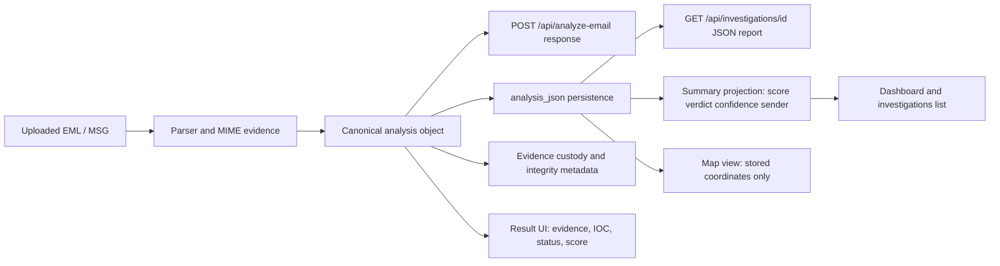

# Phase 3 — Step 15: Data Lineage and Report Consistency

**Status: Step 15 implementation and focused regression gate complete.** No PDF export endpoint or standalone JSON download feature exists in the inspected application; the persisted investigation detail API is the JSON report consumed by the UI. This step verifies that existing output path and does not add an export feature. Phase 4 has not started.

## A. Data lineage



The canonical object is the analysis dictionary returned by `backend/main.py::_analyze_email`, stored as `investigations.analysis_json`, and returned by `GET /api/investigations/{id}` as `investigation.analysis`. Dashboard/list APIs are deliberately scalar projections from that record. The map endpoint reads only coordinates already present in the stored analysis. There is no PDF/JSON file-export implementation in `frontend/script.js` or report routes.

## B. Canonical schema and audited fields

No second canonical result format was introduced. The verified result shape keeps the existing API contract and includes:

- `basic_information` and `source_evidence` for message identity and original evidence digest.
- `parsing`, `received_chain`, `url_evidence`, `urls`, `url_summary`, `threat_intelligence.iocs`, and `ioc_summary` for source-linked indicators and hop evidence.
- `email_forensics.authentication_analysis.validation` plus `result_statuses.authentication` for provider/validator and canonical authentication states.
- `threat_analysis.score`, `verdict`, `confidence`, `score_source`, and `degraded_mode`; `intelligence_fusion` remains the Phase 2 score authority when valid.
- `evidence_governance` with separate custody verification, anchor provider and trust-level fields.

The result UI’s authentication card was a demonstrated lineage ambiguity: it displayed `analysis.authentication` (reported header values) as if those were validated. It now displays the canonical status and independent validator status alongside the untrusted message-header claim, preserving the distinction.

## C. Consistency matrix

| Field | Analysis API | Dashboard/list model | JSON report detail | Result UI | Result |
|---|---|---|---|---|---|
| Risk score / verdict / confidence | `threat_analysis` | Persisted scalar projection | Same stored `analysis` object | Reads `threat_analysis` | Match asserted in integration test |
| Sender identity | `basic_information.from` | Persisted `sender` | Same stored `analysis` object | Reads basic information | Match asserted |
| URL unique count | `url_summary.unique_count` | Not independently recomputed | Preserved | Reads canonical summary; legacy array fallback only when summary is absent | Match asserted |
| URL occurrences | `url_summary.occurrence_count` | Not used as unique count | Preserved | Evidence panel uses source locations | Match asserted |
| URL IOC count | `threat_intelligence.ioc_summary.url` | Not independently recomputed | Preserved | Reads canonical IOC summary | Equals URL unique count in fixture |
| Authentication | Independent validation plus reported headers | Confidence/verdict projection only | Preserved | Now shows canonical state, validator detail, and reported header separately | Source distinction preserved |
| Relay hops | `received_chain` collection | Not independently recomputed | Preserved | Uses collection length | No alternate extractor in dashboard |
| Result statuses | `result_statuses` | Corrupt-document projection becomes ERROR | Preserved | Coverage panel reads canonical states | Match asserted |
| Evidence integrity | Custody hashes and anchor receipt | Not summarized as an external trust claim | Preserved | Calls section “Integrity anchor”; local trust explicitly says it is not external immutability proof | Scope explicit |

**Intentional difference:** URL occurrence count counts source appearances across MIME locations; URL unique count and URL IOC count count deduplicated canonical URL records. Duplicate text/HTML occurrences therefore do not imply extra unique IOCs.

## D. Before/after behavior and verification

| Case | Before | After |
|---|---|---|
| Standard same-fixture result | API and persisted report paths were not compared by one regression | Integration test asserts API analysis equals persisted JSON report exactly and dashboard projection matches score/verdict/confidence/sender |
| Duplicate URL evidence | URL and IOC counts could be read independently | Fixture reports 2 unique URL records, 4 occurrences across source locations, 2 URL IOCs, and `counts_consistent=true` |
| Corrupt saved JSON | Detail route returned `{}` with HTTP 200; map route returned empty nodes as ordinary success; dashboard kept stale scalar “LOW RISK / 0” | Detail route returns explicit `analysis_document_status=ERROR`, unknown score and report error state; map status is ERROR; dashboard SQL projection suppresses stale score and emits `REPORT DATA UNAVAILABLE` |
| Authentication result | UI prominently showed reported SPF/DKIM/DMARC values without adjacent validated result | UI distinguishes canonical state, validator output and untrusted message-header claim |
| Local anchor | Section title said “INDEPENDENT INTEGRITY” even when trust level was local | Section says “INTEGRITY ANCHOR”; local trust level carries a scope note and does not claim external immutability |

**Focused command** (run from `backend`):

```powershell
.\venv\Scripts\python.exe -m pytest -p no:cacheprovider -q tests\test_phase3_step15_report_consistency.py tests\test_phase3_step14_explicit_states.py tests\test_phase3_step13_ioc_normalization.py tests\test_phase3_step12_url_extraction.py tests\test_phase3_step11_header_mime_parsing.py tests\test_domain_alignment_evidence.py tests\test_phase2_step10_gate.py services\integrity_anchoring\tests\test_integrity_anchor_engine.py
```

**Result:** 60 passed, 0 failed, 0 skipped. Backend `py_compile` passed for changed Python modules; `node --check frontend/script.js` passed. No whole-repository suite was run.

## E. Changed files, compatibility and remaining gaps

- `backend/routes/investigations.py` — report JSON decoding failures are now explicit instead of silently becoming `{}`; errors are bounded.
- `backend/database/database.py` — summary query checks that stored analysis is a JSON object without returning/loading the forensic document; corrupt rows no longer project a stale risk score or verdict.
- `backend/main.py` — map view exposes ERROR/UNKNOWN when stored analysis is corrupt or lacks coordinates; server exceptions are bounded.
- `frontend/script.js`, `frontend/style.css` — authentication lineage is explicit; unknown list scores display as unavailable; local integrity-anchor scope is stated.
- `backend/tests/test_phase3_step15_report_consistency.py` — API/detail/dashboard/URL/status/integrity and corrupt-record consistency regressions.
- `phase3_step15_report_consistency.md` — this handoff.

Compatibility remains additive: API keys and report object structure remain intact, with new `analysis_document_status` and map `status`/`message` fields. Corrupt legacy records now return an explicit error-shaped analysis and no numeric risk claim. Dashboard SQL uses SQLite JSON functions (`json_valid`, `json_type`), available in the repository’s supported Python SQLite runtime.

Remaining gaps: there is no PDF/file export channel to compare; a browser-driven visual test was not run; summary SQL validates JSON shape, while semantic consistency against every nested field is covered by the integration fixture rather than recomputed for all records on each dashboard request; and legacy rows already containing semantically stale but valid JSON remain unchanged. These do not invalidate the tested report lineage but should be considered before offering exports or production migrations.

**Phase gate:** Steps 11–15 focused tests passed together, covering bounded parsing, shared URL extraction, IOC normalization/provenance, explicit result states and output consistency. Step 15 is ready for review. Do not start Phase 4 without explicit approval.
